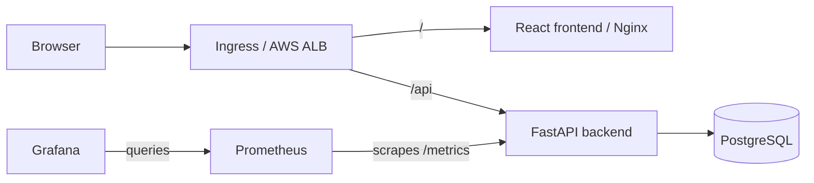

# StockFlow: implementation and DevSecOps workflow

Prepared: 15 October 2026 (IST).

## 1. What we will build

**StockFlow is an inventory and stock management application.** A user maintains a product catalog, receives stock, issues stock, and sees current inventory and low-stock alerts.

The technology and delivery architecture follow the TaskBoard reference. The application screens, database, API, tests, and business rules are specific to inventory management. The rubric permits the same DevOps architecture but requires your own application domain and meaningful changes. See the [grading policy](https://github.com/Nency-Ravaliya/devsecops-python/blob/main/GRADING.md).

Start with this scope:

- Product CRUD: create, list, view, update, and delete eligible products.
- Unique SKU, name, category, description, unit price, and reorder level.
- Stock-in and stock-out transactions with a permanent movement history.
- Reject a stock-out request when there is insufficient stock.
- Search and category filters.
- Dashboard: product count, low-stock count, inventory value, and recent movements.
- Responsive interface with loading, empty, success, and error states.

Suppliers, barcode scanning, purchase orders, notifications, and multiple warehouses can be later extensions. Complete the scope above before adding them.

## 2. What is ready and what remains

| Item | Current status |
|---|---|
| Git, Python 3.12, Node 22, npm | Installed and checked |
| Docker Desktop, Linux engine, Compose | Checked using a working verification container |
| AWS CLI v2, Terraform, kubectl, Helm 3, Trivy | Installed and checked |
| PostgreSQL 16 container image | Downloaded |
| Reference backend dependencies and tests | Dependencies installed; 3 existing tests passed |
| Reference frontend dependencies and build | Dependencies installed; build passed |
| StockFlow backend, migrations, and PostgreSQL tests | Implemented; 49 tests passed after frontend filter support |
| StockFlow React frontend | Implemented; see FRONTEND_VERIFICATION.md |
| GitHub/GHCR and AWS account configuration | To configure and verify |
| StockFlow containers and persistent Compose application stack | Implemented; see CONTAINERS.md |
| StockFlow CI, infrastructure, GitOps, monitoring | To implement |

StockFlow now runs in a verified, persistent Docker Compose stack. CI/security and cloud deployment remain to implement. Current startup instructions are in the [README](../README.md), with evidence in [container verification](CONTAINERS.md).

This file is an execution plan. Commands involving `stockflow`, manifests, workflows, or charts require the corresponding files to be created in the indicated phase first. Creating this guide does not create cloud resources.

## 3. Architecture and delivery flow



```text
Write code -> commit/push -> GitHub Actions
                            |-- pytest + PostgreSQL migration checks
                            |-- frontend production build
                            |-- build both container images
                            |-- Trivy scan the built images
                            `-- publish those exact images to GHCR with SHA tags

Terraform -> VPC + subnets + NAT + EKS + worker nodes + required IAM
Cluster bootstrap -> storage + ingress controller + metrics + monitoring + ArgoCD
Release values commit -> ArgoCD -> Helm templates -> EKS workloads
```

Terraform creates infrastructure separately from the application release workflow. ArgoCD owns application deployment after GitOps is enabled.

| Component | Choice |
|---|---|
| Frontend | React + Vite; Nginx serves the production build |
| Backend | FastAPI + SQLAlchemy + Pydantic |
| Database | PostgreSQL 16; Alembic migrations |
| Tests | pytest, HTTPX/TestClient, isolated PostgreSQL integration tests |
| Local runtime | Docker Compose |
| CI and images | GitHub Actions, Trivy, GHCR |
| Infrastructure | Terraform, AWS VPC, conventional EKS managed node group |
| Kubernetes delivery | Helm 3 chart and ArgoCD |
| Ingress | AWS Load Balancer Controller with an ALB Ingress |
| Storage | EBS CSI driver, IAM permissions, gp3 StorageClass, PostgreSQL PVC |
| Observability | Metrics Server, kube-prometheus-stack, Grafana |

For a new deployment, use AWS Load Balancer Controller rather than the retired community `ingress-nginx` project. Its retirement was scheduled for March 2026; Nginx serving the frontend is a separate component. [Kubernetes notice](https://kubernetes.io/blog/2025/11/11/ingress-nginx-retirement/)

## 4. Repository layout

The new local repository is at `C:\Users\Piyush\OneDrive\Desktop\Capstone\stockflow`. The reviewed reference repository remains separate. The layout below includes planned later-stage files as well as completed backend files.

```text
stockflow/
  backend/
    app/
      main.py
      config.py
      db.py
      models.py
      schemas.py
      routes/                 # products, movements, dashboard
      services/               # transactional stock operations
    alembic/versions/
    tests/
    alembic.ini
    pytest.ini
    requirements.txt
    Dockerfile
  frontend/
    src/
      components/
      pages/
      services/               # API client and error handling
    package.json
    package-lock.json
    vite.config.js
    nginx.conf.template
    Dockerfile
  .github/workflows/
    ci.yml
  terraform/
    versions.tf
    main.tf
    variables.tf
    outputs.tf
    terraform.tfvars.example
    .terraform.lock.hcl
  helm/stockflow/
    Chart.yaml
    values.yaml
    values-prod.yaml
    templates/                # workloads, Services, PVC, migration Job, Ingress, HPA
  argocd/application.yaml
  k8s/namespace.yaml
  k8s/bootstrap/               # pinned add-on configuration and setup notes
  monitoring/
    prometheus-values.yaml
    stockflow-dashboard.json
  scripts/
    load-test.ps1
  docs/
    WORKFLOW.md
    RUNBOOK.md
  demo/
    screenshots/
    presentation.pptx         # or slides.pdf
    walkthrough.mp4           # or documented GitHub release asset
  docker-compose.yml
  compose.test.yml
  .env.example
  .gitignore
  README.md
```

The diagram shows intended files; they are not already generated. Reuse useful patterns from the reference after reviewing them, and implement StockFlow's own behavior. Do not copy the reference `.git` directory or its broken configuration unchanged.

## 5. Database and API contract

### Products

| Field | Rule |
|---|---|
| `id` | Generated primary key |
| `sku` | Required, unique, normalized consistently, e.g. uppercase |
| `name` | Required; bounded length |
| `description` | Optional text |
| `category` | Bounded text |
| `unit_price` | Nonnegative PostgreSQL numeric value; use Decimal in Python |
| `quantity` | Integer, starts at zero; never negative |
| `reorder_level` | Nonnegative integer |
| `created_at`, `updated_at` | UTC timestamps |

### Stock movements

| Field | Rule |
|---|---|
| `id` | Generated primary key |
| `product_id` | Foreign key to the product |
| `movement_type` | `IN` or `OUT` |
| `quantity` | Positive integer |
| `note` | Optional bounded text |
| `created_at` | UTC timestamp |

Business rules:

1. Create products with zero quantity. Receive initial stock through a movement.
2. Product edits change metadata, not quantity. Only movement transactions change stock.
3. Update quantity and insert the movement in **one database transaction**.
4. Prevent concurrent stock-out requests from overselling. Use a row lock or an atomic conditional update; keep a database nonnegative-quantity constraint too.
5. An unsuccessful movement must leave both quantity and history unchanged.
6. Movement history is read-only. A correction is a compensating movement.
7. Allow deletion only for a product with no movement history. Otherwise return `409 Conflict`, preserving the ledger. Demonstrate DELETE with a newly created unused product.
8. A product is low stock when `quantity <= reorder_level`.

| Method | Endpoint | Purpose |
|---|---|---|
| GET | `/health` | Process health; does not depend on the database |
| GET | `/ready` | Database/schema readiness; return 503 when unavailable |
| GET | `/metrics` | Prometheus metrics |
| GET | `/api/products` | List, search, category filter, pagination |
| GET | `/api/products/{id}` | Product detail |
| POST | `/api/products` | Create product; 201 on success |
| PUT | `/api/products/{id}` | Update editable product metadata |
| DELETE | `/api/products/{id}` | Delete unused product; 204 on success |
| POST | `/api/products/{id}/movements` | Receive or issue stock; 201 on success |
| GET | `/api/products/{id}/movements` | Product movement history |
| GET | `/api/dashboard` | Totals, low-stock products, recent movements |

Use 404 for missing products, 409 for duplicate SKUs or business-rule conflicts, and 422 for invalid request fields. Publish request/response schemas in FastAPI's `/docs`.

## 6. Phase 1: initialize the project

This repository is already initialized. The commands below describe creating it from scratch; skip them when continuing the current checkout. Run from the Capstone folder:

```powershell
Set-Location 'C:\Users\Piyush\OneDrive\Desktop\Capstone'
. .\Enter-Project.ps1
New-Item -ItemType Directory -Path stockflow
Set-Location .\stockflow
git init --initial-branch=main
```

Create the README, folder structure, `.env.example`, and `.gitignore`. Ignore real `.env` files, virtual environments, caches, `node_modules`, build output, Terraform working directories/state, local variable files, saved plans, and credentials. Commit dependency lockfiles and `.terraform.lock.hcl`.

Create your GitHub repository and connect its remote. Use a public repository or grant the instructor access as the rubric specifies. The local tool installation does not sign in to GitHub for you.

**Completion check:** a separate StockFlow repository exists with its purpose, scope, API plan, and initial meaningful commit.

## 7. Phase 2: implement the backend and database

Implementation order:

1. Settings and database connection from `DATABASE_URL`.
2. SQLAlchemy models and database constraints.
3. Alembic configuration and initial migration for both tables.
4. Product schemas and CRUD routes.
5. Transactional stock movement service and routes.
6. Dashboard aggregation queries.
7. `/health`, database/schema-aware `/ready`, and `/metrics`.
8. Consistent error responses and useful logs.

Pin compatible dependencies in `backend/requirements.txt`. Keep credentials outside source code. Keep frontend/backend on the same origin in production; configure explicit localhost origins only where direct development requires CORS.

Once the Compose database and migration service are defined in Phase 4, direct backend development uses:

```powershell
# From stockflow/, with Enter-Project.ps1 already loaded.
docker compose up -d --wait postgres
docker compose run --rm migrate
Set-Location .\backend
python -m pip install -r requirements.txt
# Set DATABASE_URL locally to your .env database credentials and localhost:5432.
python -m uvicorn app.main:app --reload --port 8000
```

The application should load the local environment file explicitly, or the development terminal must set `DATABASE_URL`. Do not assume that a Compose `.env` automatically configures a separately launched Python process.

**Completion check:** Swagger UI can create a product, receive 10 units, issue 3, show 7 remaining, and reject a request to issue 8.

## 8. Phase 3: implement the frontend

Create the React/Vite application in `frontend/`. The official scaffolding command is:

```powershell
# From stockflow/.
npm.cmd create vite@latest frontend -- --template react
Set-Location .\frontend
npm.cmd install
npm.cmd run dev
```

Use the installed Node 22. Pin the selected dependency versions and commit `package-lock.json`; use `npm.cmd ci` for subsequent clean installs. [Vite setup](https://vite.dev/guide/)

Build these pages/components:

- Dashboard with inventory summary and low-stock list.
- Product table with search, filters, and quantity indicators.
- Add/edit product form with validation.
- Receive/issue stock dialog with quantity and note.
- Movement history view.
- Delete action for eligible products, with confirmation and useful conflict errors.

Use relative `/api/...` URLs. The Vite development server runs on 5173 and proxies `/api` to `http://localhost:8000`. Check `response.ok` before treating a write as successful; retain form values and show API errors on failure.

```powershell
# From frontend/.
npm.cmd run build
```

**Completion check:** the full receive/issue/reject workflow works through the browser, quantities refresh correctly, and the UI is usable on narrow screens.

## 9. Phase 4: make Docker Compose the reliable local entry point

Create backend and frontend Dockerfiles and Compose configuration. Run both application images as non-root users. Use a frontend multi-stage build and an unprivileged Nginx runtime listening on 8080.

| Service | Container port | Local access |
|---|---|---|
| PostgreSQL | 5432 | localhost:5432 for direct development |
| Backend | 8000 | http://localhost:8000/docs |
| Frontend | 8080 | http://localhost:3000 |
| Migration job | None | One-shot service; exits after Alembic succeeds |

Required startup order:

```text
PostgreSQL healthy -> migration service exits successfully -> backend ready -> frontend
```

Use a PostgreSQL healthcheck and Compose `depends_on` conditions. Give PostgreSQL a named volume. Run migrations once through the migration service, rather than having every backend replica run migrations at startup.

Nginx must serve SPA routes and forward local `/api` requests to the Compose backend. Make the upstream configurable for the environment; do not carry the Compose hostname `backend` into Kubernetes unless that Service actually exists. In Kubernetes, the ALB routes `/api` directly to the backend Service.

```powershell
# From stockflow/, after creating .env from .env.example with local values.
docker compose config --quiet
docker compose up --build
```

In another terminal, open the UI and verify the backend:

```powershell
Invoke-RestMethod 'http://localhost:8000/health'
Invoke-RestMethod 'http://localhost:8000/ready'
docker compose ps
docker compose logs backend
```

Create data, run `docker compose down`, and start again. Confirm that the same product and history remain. Preserve the named volume during this check; `down -v` deletes it.

**Completion check:** one `docker compose up --build` starts the usable application; data survives a normal restart. Capture browser and terminal evidence now.

## 10. Phase 5: add meaningful tests

The rubric minimum is **5 tests covering at least 3 endpoints**. Implement at least these cases:

1. Health endpoint returns 200.
2. Valid product creation returns 201 with quantity zero.
3. Duplicate SKU returns 409.
4. Product list/detail returns the created product.
5. Product metadata update works.
6. Stock-in updates quantity and records a movement.
7. Valid stock-out decreases quantity.
8. Excess stock-out returns 409 and changes neither quantity nor history.
9. Zero/negative movement quantities are rejected.
10. An unused product can be deleted; a product with history cannot.
11. Dashboard totals and low-stock results are correct.
12. Missing product returns 404.

Use fixtures in `tests/conftest.py` and a dedicated test database. `compose.test.yml` should provide an isolated PostgreSQL service, for example on host port 5433, with disposable data and its own credentials. Test configuration must never target the development database.

```powershell
# From stockflow/; TEST_DATABASE_URL must match the isolated test service.
docker compose -f compose.test.yml up -d --wait
Set-Location .\backend
python -m pytest -v
```

Also verify migrations against an empty PostgreSQL test database and concurrent stock-out behavior. SQLite-only tests do not establish PostgreSQL locking or migration correctness. Run these PostgreSQL checks in CI too.

**Completion check:** tests pass, failures produce a nonzero exit code, and test execution leaves development records untouched. Save the passing output.

## 11. Phase 6: implement CI, scanning, and GHCR publishing

Create the active workflow under `.github/workflows/`; a YAML file at the repository root does not run as a GitHub Actions workflow.

Pull requests: tests, frontend build, container builds, and security validation.

Push to `main`: the same validation, followed by publication of the release images after all gates pass.

Release sequence:

1. Check out the exact commit and set up matching Python/Node versions.
2. Start an isolated PostgreSQL test service; apply migrations and run pytest.
3. Run `npm ci` and the frontend production build.
4. Build each release image once, making it available locally for Trivy.
5. Scan both images and save reports as artifacts.
6. Publish **the exact scanned images**, without rebuilding between scan and push.
7. Expose the source commit SHA and image digests in the workflow summary.

Image names:

```text
ghcr.io/YOUR_LOWERCASE_GITHUB_OWNER/stockflow-backend:<source-commit-sha>
ghcr.io/YOUR_LOWERCASE_GITHUB_OWNER/stockflow-frontend:<source-commit-sha>
```

Use the workflow's `GITHUB_TOKEN` with `contents: read` and `packages: write` for GHCR publication. Do not publish from untrusted pull-request jobs. GitHub documents this registry workflow in its [image publishing guide](https://docs.github.com/en/actions/tutorials/publish-packages/publish-docker-images).

The security gate must explicitly fail:

```text
trivy image --severity HIGH,CRITICAL --exit-code 1 <exact-built-image:sha>
```

Fix prohibited findings; do not remove the failure flag to obtain a green build. The initial policy should include all HIGH/CRITICAL findings rather than silently excluding unfixed CVEs. [Trivy exit-code configuration](https://trivy.dev/docs/latest/configuration/others/)

Make demo packages public for straightforward pulling, or configure an image-pull Secret for **both** frontend and backend, including migration Jobs. Public repository visibility does not automatically make GHCR packages public.

**Completion check:** a successful main-branch run publishes both SHA-tagged images; a failing test or prohibited vulnerability prevents publication. Capture the run URL, scan reports, and package screenshots.

## 12. Phase 7: configure AWS and provision infrastructure

Choose the account, region, cluster name, budget, and authentication method before infrastructure work. Suggested names: region `ap-south-1`, cluster `stockflow-eks`, namespace `stockflow`.

If your AWS account uses IAM Identity Center:

```powershell
aws configure sso --profile capstone
aws sso login --profile capstone
$env:AWS_PROFILE = 'capstone'
$env:AWS_REGION = 'ap-south-1'
aws sts get-caller-identity
```

This requires a valid organization/start URL and assigned role. If your course supplies another credential method, configure that method locally instead. Keep credentials out of Git and chat. [AWS SSO setup](https://docs.aws.amazon.com/cli/latest/userguide/cli-configure-sso.html)

Implement valid multiline Terraform for:

- VPC, two Availability Zones, at least two public and two private subnets.
- Internet access and NAT for private workers, with load-balancer discovery subnet tags.
- EKS control plane and managed worker node group; two suitably sized workers are a starting point, with capacity checked for monitoring and application pods.
- EKS access for the operator, plus the CNI, CoreDNS, and kube-proxy prerequisites.
- OIDC/IRSA and scoped IAM roles for the EBS CSI driver and AWS Load Balancer Controller.
- Inputs for region, cluster name, Kubernetes version, environment, and node sizing.
- Useful outputs and a credential-free `terraform.tfvars.example`.

Choose a Kubernetes version currently in standard support in your region and compatible with the installed kubectl and selected Terraform modules/providers. Do not copy the reference's old `1.31` value blindly. Inspect available versions with `aws eks describe-cluster-versions --region ap-south-1 --output table`, then check the [EKS lifecycle](https://docs.aws.amazon.com/eks/latest/userguide/kubernetes-versions.html).

```powershell
# From stockflow/terraform, after implementing the files and local tfvars.
terraform fmt -recursive
terraform init
terraform validate
terraform plan -out=capstone.tfplan
```

Review the actual resources and expected running cost before applying the saved plan. EKS, EC2, NAT, load balancers, and disks are billable; this is a real cloud deployment.

```powershell
terraform apply capstone.tfplan
aws eks update-kubeconfig --region ap-south-1 --name stockflow-eks
kubectl get nodes
```

Keep state and saved plans out of Git; preserve the provider lockfile. For this single-operator capstone, secure local state can be used initially; document where it lives and retain it for cleanup. Configure a locking remote backend before shared Terraform operation.

**Completion check:** Terraform validates, the reviewed plan applies, nodes are Ready, and the expected VPC/EKS resources appear in AWS. Save plan and infrastructure evidence.

## 13. Phase 8: bootstrap Kubernetes and implement Helm

Install and verify these dependencies before the application:

| Dependency | Required configuration / check |
|---|---|
| EBS CSI driver | Correct IAM role; gp3 StorageClass; test PVC becomes Bound |
| AWS Load Balancer Controller | Correct IAM role, VPC/region, controller CRDs and any prerequisite CRDs required by its selected version; controller Ready |
| Metrics Server | `kubectl top nodes` works |
| kube-prometheus-stack | Operator/ServiceMonitor CRDs exist; Prometheus/Grafana pods Ready |
| ArgoCD | Controller/server Ready; access through local port-forward initially |

Pin tested add-on/chart versions and document bootstrap commands in `k8s/bootstrap/README.md`. Manage IAM with Terraform rather than adding an untracked second infrastructure workflow. AWS's [controller installation guide](https://docs.aws.amazon.com/eks/latest/userguide/lbc-helm.html) uses eksctl for IAM examples; translate that part into Terraform for this project. Configure EBS storage following the [AWS storage guide](https://docs.aws.amazon.com/eks/latest/userguide/ebs-csi.html).

Build the StockFlow Helm chart with:

- Frontend and backend Deployments with at least two replicas each.
- Resource requests/limits, non-root security settings, startup/readiness/liveness probes.
- ClusterIP Services: frontend service port 80 -> container 8080; backend service port 8000 -> container 8000.
- One PostgreSQL instance with a PVC and Secret-based credentials; do not scale PostgreSQL with the application HPA.
- A controlled migration Job, using the same backend release image.
- Backend HPA with minimum 2 replicas, a defined maximum, and CPU requests.
- ServiceMonitor selecting the backend Service's named `http` metrics port.
- ALB Ingress: `/api` -> backend:8000 and `/` -> frontend:80, using Prefix paths and the actual rendered Service names.
- ALB IP target mode so frontend/backend Services can remain ClusterIP; configure working target health checks for each service.

Use `ingressClassName: alb` with a matching installed IngressClass. Start with the ALB-generated hostname so purchasing a domain is not required. An optional hostname must resolve to the ALB. [AWS ALB Ingress requirements](https://docs.aws.amazon.com/eks/latest/userguide/alb-ingress.html)

Database startup and migration ordering must work in both manual Helm and ArgoCD deployments: DB ready -> one migration Job succeeds -> application becomes ready. For Helm, let the migration Job wait/retry for DB readiness and gate backend startup on the expected schema revision. For ArgoCD, use database resources in an earlier sync wave, a Sync migration hook in the next wave, and application workloads afterward. A first-install PreSync migration hook cannot depend on a database that has not been created yet.

Create database Secrets outside committed plaintext values. Configure a pre-existing Secret reference in the chart. If the registry is private, provide the pull Secret in every namespace used by the application or the Helm validation release.

```powershell
# From stockflow/.
helm lint .\helm\stockflow
helm template stockflow .\helm\stockflow -n stockflow -f .\helm\stockflow\values-prod.yaml
```

### Capture manual Helm evidence without conflicting with ArgoCD

Use a disposable `stockflow-smoke` namespace for a real Helm release. Configure its Secrets and valid image tags first. Disable external ingress and ServiceMonitor for this short check; verify the application with a port-forward and verify PVC/probes/migrations.

```powershell
helm upgrade --install stockflow-smoke .\helm\stockflow -n stockflow-smoke --create-namespace -f .\helm\stockflow\values-prod.yaml --set ingress.enabled=false --set monitoring.serviceMonitor.enabled=false --wait --timeout 10m
helm list -n stockflow-smoke
kubectl get pods,svc,pvc -n stockflow-smoke
```

Save screenshots. Remove the disposable smoke release before deploying the real GitOps application so the node group has capacity. Delete its disposable PVC/namespace only after confirming it contains no required data.

**Completion check:** chart lint/render succeeds; a manual Helm release runs with two frontend/backend replicas and persistent storage. Chart labels and service names must work for arbitrary release names and namespaces.

## 14. Phase 9: configure GitOps with ArgoCD

Create `argocd/application.yaml` pointing to your repository, main branch, `helm/stockflow` path, `values-prod.yaml`, destination cluster, and `stockflow` namespace. Create database/pull Secrets in that namespace before the first application sync.

Start with manual sync so you can inspect the first deployment. Enable automated reconciliation after the initial release is healthy. ArgoCD uses Helm to render templates and owns the lifecycle; it does not create an ordinary Helm release entry. Keep the separate smoke-release evidence for the rubric's `helm list` requirement. [ArgoCD Helm integration](https://argo-cd.readthedocs.io/en/latest/user-guide/helm/)

```powershell
# From stockflow/, after installing ArgoCD and creating the Application manifest.
kubectl apply -f .\argocd\application.yaml
kubectl get applications -n argocd
kubectl get pods,svc,ingress,pvc,hpa -n stockflow
```

First release:

1. Take the source SHA from a successful CI run that published both images.
2. Put that exact SHA into both image tags in `values-prod.yaml` and commit it.
3. Sync the ArgoCD Application and inspect rollout events and logs.
4. Verify the app through the ALB hostname, including stock movement and persistence.

Next releases: code commit -> green CI/published images -> release-values commit -> ArgoCD sync. Update values manually first; automate tag-update PRs later. Configure CI paths/jobs so a values-only tag commit does not create an endless build/tag-update cycle.

Do not also run an Actions Helm deployment against the same GitOps application. If Actions only publishes GHCR images, it does not need AWS deployment credentials. Add GitHub OIDC only if an AWS-calling Actions job is actually introduced.

Demonstrate rollback by reverting a release-values commit to a known compatible image SHA. Keep migrations backward-compatible with the rollback version; changing an image tag does not undo a database migration.

**Completion check:** the application is Synced/Healthy, its deployed image tags match Git, and one release plus a rollback is demonstrated.

## 15. Phase 10: monitoring, scaling, and recovery

Configure Prometheus to discover StockFlow's ServiceMonitor; match the operator's release labels, namespace selection, Service labels, and named port. Commit a Grafana dashboard JSON and its provisioning configuration, not just a screenshot.

Dashboard panels:

- HTTP request rate.
- Request latency, preferably histogram-based p95.
- HTTP 5xx error rate.
- Backend pod CPU/memory using cluster metrics.

Use metric names actually emitted by the selected instrumentation version. Generate browser/API traffic and confirm the panels show current data; Prometheus's target must be UP.

```powershell
kubectl get pods,svc,ingress,pvc,hpa -n stockflow
kubectl top pods -n stockflow
kubectl get events -n stockflow --sort-by=.lastTimestamp
```

Build `scripts/load-test.ps1` as a bounded concurrent test against read endpoints, with visible failures and a fixed duration. Do not load-test stock-out endpoints against important data. Observe HPA metrics before/during/after the test. HPA scales application pods; it does not itself add worker nodes. [HPA documentation](https://kubernetes.io/docs/concepts/workloads/autoscaling/horizontal-pod-autoscale/)

For the recovery demonstration, delete one expendable backend pod and show the Deployment replacing it. Use a separate disposable lab namespace for deliberate bad-image or bad-Service exercises. Collect events/logs and document the diagnosis.

**Completion check:** a live Grafana dashboard, healthy Prometheus target, functioning HPA metrics, a documented load result, and a demonstrated recovery. Do not claim scaling occurred if the observed load did not trigger it.

## 16. Phase 11: evidence, documentation, and submission

Keep screenshots as each phase passes rather than reconstructing them at the end.

| Rubric area | Evidence |
|---|---|
| Application, 10 points | StockFlow UI, CRUD, PostgreSQL tables/migrations, real stock workflow |
| Testing, 10 | At least 5 tests / 3 endpoints; passing output and isolation |
| Git/GitHub, 5 | Repository URL, useful README/ignore rules, at least 10 meaningful commits |
| Docker, 10 | Both Dockerfiles, multi-stage/non-root proof, Compose run and browser |
| CI/CD, 15 | Green main run, frontend/backend images in GHCR, source SHA tags |
| Security, 5 | Both Trivy reports, failure gate, short explanation of findings/clean result |
| Terraform, 15 | Valid code, plan, VPC/EKS proof, example variables, destroy completion |
| Kubernetes/Helm, 15 | Chart, Helm smoke release, two replicas each, Services, Ingress, Ready pods |
| Observability, 10 | Metrics output, Prometheus target UP, populated Grafana panel |
| Presentation/docs, 5 | README, mandatory walkthrough video, slide deck |

Create at least 8 slides: problem/features, stack, architecture, tests/local runtime, CI/security, Terraform/AWS, Kubernetes/GitOps, monitoring/recovery/learnings. More than 8 is fine if clearer.

Record the video in the submission order: slides -> codebase -> CI/CD -> Terraform/AWS -> ArgoCD -> Kubernetes -> Prometheus -> Grafana. Include the working application and registry evidence. Store the deck and video under `demo/`, or use a GitHub release asset for the video and link it clearly.

A meaningful commit sequence can follow: scope/scaffold, database/migration, product APIs, stock transactions, dashboard APIs, frontend, tests, containers, CI/security, Terraform, Helm/bootstrap, GitOps, monitoring, documentation/demo. Commit actual completed increments; do not fabricate history.

The submission document states **19 October 2026, 11:59 PM IST**, while calling that date Sunday. The date is Monday; confirm the instructor's intended deadline. Source: [SUBMISSION.md](https://github.com/Nency-Ravaliya/devsecops-python/blob/main/SUBMISSION.md). Submit the final repository link through its linked form.

## 17. Phase 12: cleanup after evaluation

Retain the application until evaluation is complete. Then back up any data you need and remove resources in dependency order:

1. Stop ArgoCD from recreating resources: disable automated sync/self-heal and remove the Application using the chosen cascading-deletion policy, or remove the workloads from Git and sync while controllers still run.
2. Remove the application Ingress/load-balancer resources and wait for their AWS load balancers and target groups to be removed by the controller.
3. Remove application/monitoring workloads and intentionally delete disposable PVCs. Inspect reclaim policies; retained volumes or snapshots may need separate cleanup.
4. Run Terraform destroy from the same state/backend used to create the infrastructure.

```powershell
# From stockflow/terraform, after the Kubernetes/AWS dependency cleanup above.
terraform plan -destroy
terraform destroy
```

Save the destroy completion screenshot. Verify no unintended EKS clusters, EC2 workers, NAT gateways, load balancers, EBS volumes, or billable snapshots remain. Do not delete Terraform state before cleanup succeeds.

## 18. Prompts to use while building

Send one phase at a time and require its completion check before moving on. Each prompt assumes the workflow decisions in this file.

**Prompt 1 — foundation and backend**

> Implement StockFlow from STOCKFLOW_WORKFLOW.md in a new stockflow repository. Start with the scaffold, models, Alembic migrations, product CRUD, transactional stock movements, dashboard API, health/readiness, and metrics. Add isolated tests including insufficient stock and PostgreSQL migration coverage. Keep an inventory ledger and prevent concurrent overselling. Run the relevant checks and report what passed. Stop before cloud provisioning.

**Prompt 2 — frontend**

> Build StockFlow's responsive React frontend: dashboard, product search/filtering, create/edit/delete forms, receive/issue dialogs, and stock history. Connect it to the real API, handle errors and loading states, configure the Vite proxy, and verify the production build and browser workflow.

**Prompt 3 — local containers**

> Containerize StockFlow with non-root backend/frontend images and a frontend multi-stage build. Implement Compose with PostgreSQL health checks, persistent storage, a one-shot migration service, and correct startup ordering. Make docker compose up --build work and verify CRUD, stock rules, and persistence after restart.

**Prompt 4 — CI and security**

> Implement GitHub Actions with isolated PostgreSQL tests, migration checks, frontend build, both image builds, and strict Trivy HIGH/CRITICAL gates. Publish the exact scanned images to GHCR using source commit SHA tags on trusted main pushes. Keep pull requests free of publication credentials and save reports.

**Prompt 5 — infrastructure**

> Implement and validate StockFlow Terraform for VPC, subnets, EKS managed nodes, access, and the IAM prerequisites for EBS CSI and AWS Load Balancer Controller. Verify compatible supported versions. Prepare a reviewable plan and cost/resource summary before applying infrastructure.

**Prompt 6 — cluster and Helm**

> Implement StockFlow's Helm chart and documented cluster bootstrap. Include persistent PostgreSQL, ordered migrations, two frontend/backend replicas, probes, resources, ClusterIP Services, ALB Ingress, HPA, and ServiceMonitor. Validate the chart and use a disposable Helm smoke release for helm list evidence.

**Prompt 7 — GitOps**

> Configure the StockFlow ArgoCD Application using the Helm chart and SHA-tagged GHCR images. Complete the initial sync, demonstrate a release-values update and compatible rollback, and ensure Actions and ArgoCD do not both deploy the same application.

**Prompt 8 — monitoring and evidence**

> Configure StockFlow Prometheus scraping and a committed Grafana dashboard. Verify live metrics, HPA resource metrics, bounded load testing, and pod recovery. Collect the rubric evidence, finish the README/runbook, and prepare the slide and video outline.

## 19. Final acceptance checklist

- [ ] Own inventory application with a working stock ledger and no negative inventory.
- [ ] Product GET/POST/PUT/DELETE, validation, search, dashboard, and responsive UI.
- [ ] PostgreSQL migrations work from an empty database and persistence is verified.
- [ ] At least 5 tests cover at least 3 endpoints; PostgreSQL-specific behavior is checked.
- [ ] Docker Compose starts the complete local application with one command.
- [ ] Frontend/backend images are non-root; frontend uses a multi-stage build.
- [ ] Main CI passes tests/builds/scans and publishes the same SHA-tagged images to GHCR.
- [ ] No HIGH/CRITICAL scan exception silently bypasses the chosen gate.
- [ ] Terraform provisions VPC/EKS and has usable state for later destroy.
- [ ] Storage, ingress, metrics, monitoring, and ArgoCD dependencies are Ready.
- [ ] Two backend and two frontend replicas are running; Ingress serves the real app/API.
- [ ] Helm evidence and ArgoCD Synced/Healthy evidence are saved.
- [ ] A release, rollback, persistence check, and recovery demonstration are recorded.
- [ ] Prometheus target is UP and Grafana shows live metrics.
- [ ] At least 10 meaningful commits, complete README, minimum 8-slide deck, mandatory video.
- [ ] Submission repository is accessible; final cleanup is scheduled after evaluation.

Prompts 1–3 are implemented; review docs/VERIFICATION.md, docs/FRONTEND_VERIFICATION.md, and docs/CONTAINERS.md. Continue with Prompt 4 for CI/security/GHCR. Finish release verification before starting AWS deployment.
